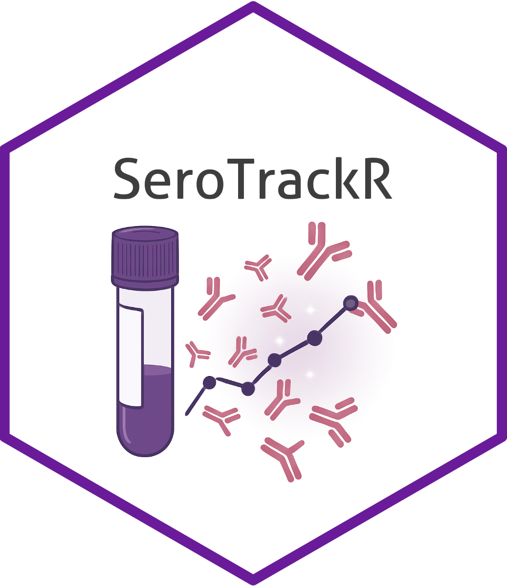
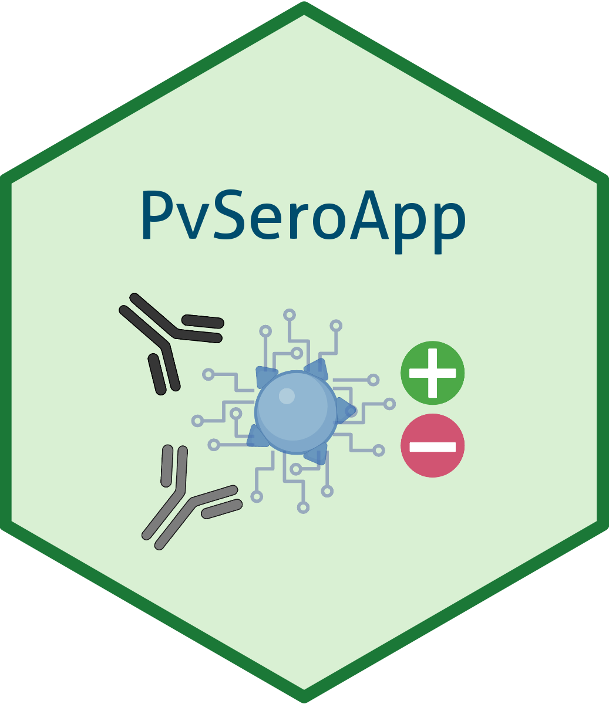
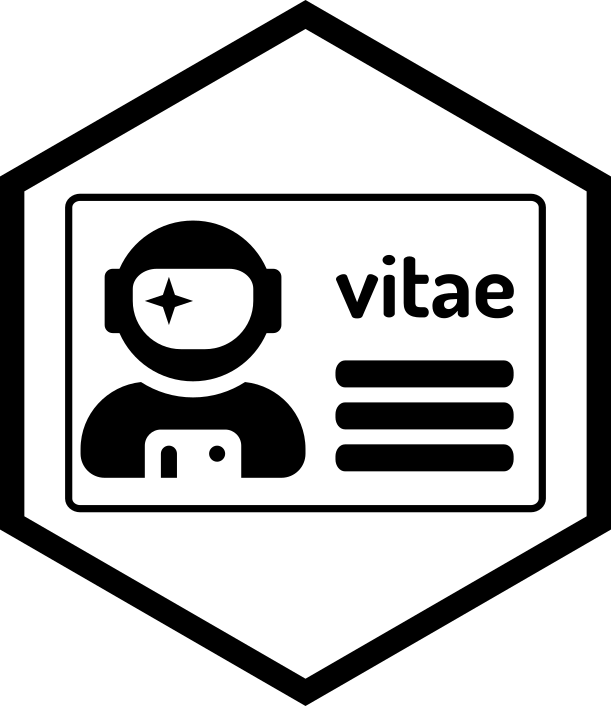
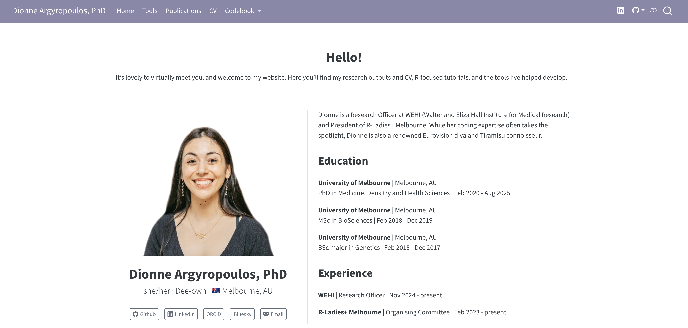
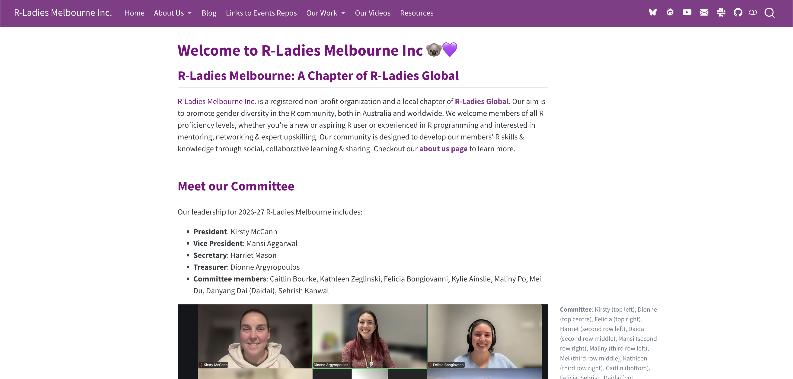
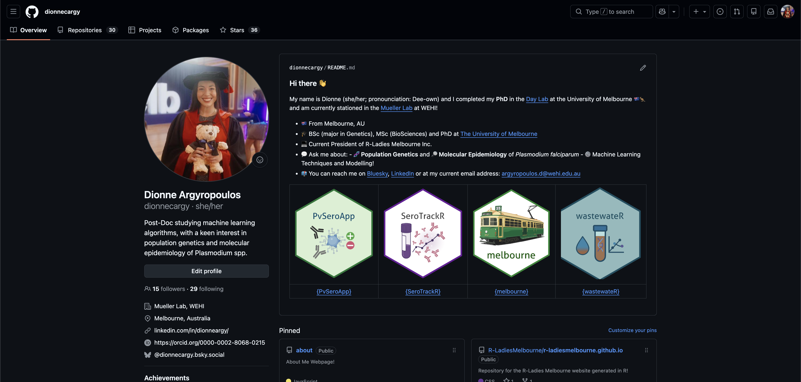
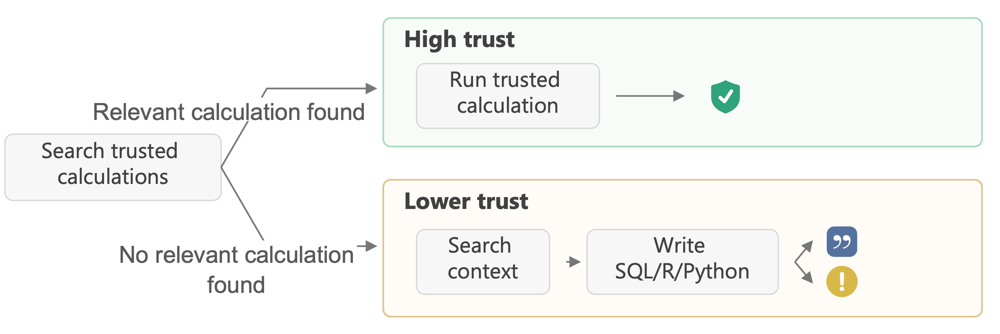
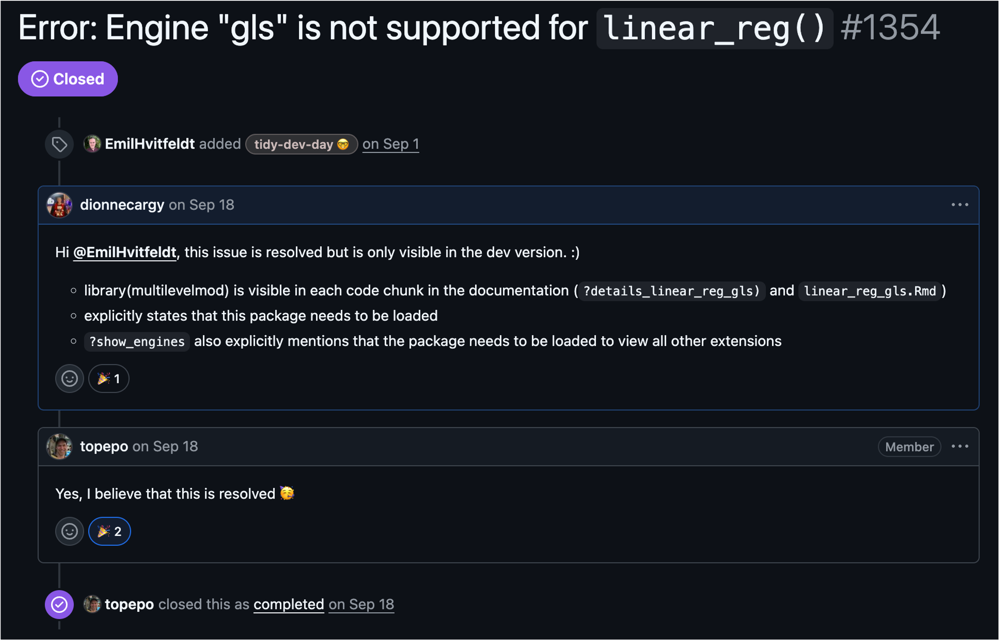

## posit::conf(2026) %>% glimpse() {#TitleSlide data-menu-title="Welcome" background-color="#881ef9" style="font-size:64px;padding: 5px "}

[How Community Creates Opportunity]{style="font-size:80%"}

[Dionne Argyropoulos, PhD and Mansi Aggarwal]{style="font-size:50%"}

## Introductions

::::: columns
::: {.column width="50%"}

:::

::: {.column width="50%"}
::: {.fragment}
We are [Mansi]{.violet} and [Dionne]{.violet}, committee members at [R-Ladies+ Melbourne]{.violet}
:::

::: {.fragment}
We both attended [posit::conf(2026)]{.violet} in Houston, Texas (USA) this September as part of the [Opportunity Scholars Program]{.violet}
:::

::: {.fragment}
Today we will discuss our journeys [before]{.rose-emph}, [during]{.blue-emph} and [after]{.green-emph} the conference! 
:::
:::
:::::

## About [Mansi]{.violet}

Include things in your application about your journey and what you do :) 

## About [Dionne]{.violet} 

::::: rows

::: {.row height="50%" style="display: flex; justify-content: center; align-items: center; gap: 2em;"}
::: {.fragment}
{height="250px"}
:::

::: {.fragment}
{height="250px"}
:::

::: {.fragment}
{height="250px"}
:::
:::

::: {.row height="50%" style="display: flex; justify-content: center; align-items: center; gap: 2em;"}
::: {.fragment}
{height="250px"}
:::

::: {.fragment}
{height="250px"}
:::
:::
:::::

:::{.notes}
- Experience with GitHub and Coding: 
  - Developer/maintainer of three R packages: `SeroTrackR`, `wastewateR`, `melbourne`
  - Developer/maintainer R Shiny Application: `PvSeroApp`
  - Written a paper on `SeroTrackR` and `PvSeroApp` fit-for-purpose tool 
  - Written my CV entirely using R Markdown via the `vitae` R package 
:::

## About [Dionne]{.violet} 



:::{.notes}
- Developer/maintainer of two websites: [personal](dionnecargy.github.io) and [R-Ladies+ Melbourne](r-ladiesmelbourne.github.io) 
- Also had to provide three links: Updated my website, provided my GitHub and R-Ladies+ Melbourne website 
:::

## About [Dionne]{.violet} 



## About [Dionne]{.violet} 



## About [Dionne]{.violet} 

Other coding contributions: 

  - Developed multiple [ebooks]{.violet} for R-Ladies+ Melbourne, lab-based protocols and my Shiny App/R package 
  - Joined [R Dev Day 2025]{.violet} in Melbourne ([`r-devel/translations-dashboard/issues/38`]((https://github.com/r-devel/translations-dashboard/issues/38#issuecomment-3568407891)))

::: {.fragment}

Experience in contributing to the community: 

  - [R-Ladies+ Melbourne]{.violet} since 2023
    - Executive roles, maintain website, slack, social media 
  - [veski Women in STEM]{.violet}: Mentor (2025, 2026)
  - [Teaching]{.violet} R courses (WEHI, UoM, It Takes A Spark)

:::

::: {.notes}
- Treasurer (current), President since 2024-2026, VP in 2023, committee 
- Organise women and gender-minority led events
- Uplift women, non-binary and gender minority groups 
- Find speakers for events and lead contact for organisation (at the time)
- Veski: Inspiring the next generation of girls in STEM
:::

## Opportunity Scholars Program

Supported by [Posit PBC]{.violet} to fly to Houston for four nights, registration for [posit::conf(2026)](https://conf.posit.co/2026/) and a workshop; (optional) for [Tidy Dev Day](https://opensource.posit.co/blog/2026-06-25_tidy-dev-day-2026/)! 

::::: columns  
::: {.column width="50%" .center}
{height="400px"}
:::

::: {.column width="50%" .center}
{height="400px"}
:::
:::::

## Timeline {.center}

::: {.timeline}
::: {.event data-label="Feb/Mar 2026"}
**Application**
📝 Draft and submit application
:::
::: {.event data-label="Apr 2026"}
**Decision**
🎉 Found out we were successful! 
:::
::: {.event data-label="Sept 2026"}
**Conference**
✈️ Fly to Houston, Texas 
:::
:::

## posit::conf(2026) %>% glimpse() {.big-statement data-menu-title="The Conference" background-color="#881ef9" style="font-size:64px;padding: 5px "}

## Workshop: "The Modern R Workflow" 

*with Jenny Bryan and Hadley Wickham*

::: {.fragment}
::::::: columns
::: {.column}
{height="100px"}

[Positron IDE]{.violet}

:::: {style="font-size: 0.7em;"}
- Built for data exploration, writing code (with/out AI)
- Familiar, RStudio-like and extensible, VSCode
- Multilingual 
- Workspace is a folder (no .RProj)
- *No need to migrate from RStudio*
::::
:::

::: {.column}
{height="100px"} {height="100px"}

[Posit Assistant]{.violet} and [Posit AI Pass]{.violet}

:::: {style="font-size: 0.7em;"}
- PA: AI **harness** geared towards needs of data scientists
- Works within IDE and connects to live session 
- Can be used with many providers 
- Posit AI Pass: Access many **models** through **one** subscription service
- It shows relative cost within the model picker
::::
:::

:::::::

:::


::: {.notes}
- Day 1: workshop with Jenny Bryan and Hadley Wickham on AI-assisted coding.
- Lunch with the other opportunity scholars was lovely; evening was the data science hangout catch-up.
- Positron vs. RStudio: 
  - RStudio still best for day-to-day R; 
  - Positron wins if you work across languages, want to customise through extensions, workflows with multiple R sessions.
- Posit Assistant
  - Various tool calls that are intuitive and have specific user-input 
  -  Tool calls: `search`, `read`, `write`, `edit`, `execudeCode`, `bash`, `AskUser`, `webfetch`
- Posit AI Pass shows token use at all times and how you compare to others.
:::

## Workshop: "The Modern R Workflow": AI/R Tips

*with Jenny Bryan and Hadley Wickham*

. . . 

💡 `/clear` conversations regularly

💡 Use `AGENT.md` to store regular instructions

💡 Ask agent to "talk like a caveman": succinct and saves tokens

💡 Create skills to avoid common pitfalls 

💡 Use tools like `air` (formatting), `pak` (installing packages), `rig` to manage multiple R installations 

💡 Kimi K3 recommended as a capable model for reasonable price 

. . .

💭 **Harness** provides the tools, **model** is specific LLM, **provider** who runs the server 

. . . 

🚨 [NEVER MAKE ANOTHER HUMAN READ AI SLOP]{.violet-emph}

::: {.notes}

- `AGENTS.md`: instructions the AI reads every session
- If AI writes your code, **comment as a human**
- Tip: put "talk like a caveman" in your AGENTS.md — saves tokens and gets to the point.
- `/clear` the Posit AI conversation regularly: conversations are additive and it resends everything in the conversation every time you continue a conversation, increasing the number of tokens used
- On tokens: 
  - Tools exist like agentsview.io shows how many tokens you use and what it costs.
- AGENT.md is a way to avoid repeating yourself across multiple conversations, apply personal preferences across projects, keep them minimalist and not build them up too much. 
- Create skills to save tokens by avoiding common pitfalls and to steer it in the right direction to something more efficient
- Use tools like `air` for formatting, `pak` for installing R packages and `rig` to manage multiple R installation
- Kimi K3 strongly recommended as a very capable model for a reasonable price
- Terminology: 
  - “Harness” provides the tools (e.g., Posit AI), 
  - “Model” is the specific LLM (e.g. Kimi K3) and 
  - “Provider” is who runs the server that runs the model (e.g. posit.ai) 
  - An agent is a model, inside a harness, running a loop, using tools, to achieve a goal. 
- Urge the audience: if you use AI for code, at least edit the comments yourself so a human voice stays in the code.

:::

## Workshop: "The Modern R Workflow": The Stakes {auto-animate=true}

::: {.big-title data-id="title" style="left:40px; top:150px; width:500px; font-size:38px;"}
The stakes of using AI in a workflow
:::

::: {.panel data-id="very-low" style="left:600px; top:150px; width:150px; height:170px;"}
:::
::: {.panel data-id="low" style="left:770px; top:150px; width:150px; height:170px;"}
:::
::: {.panel data-id="medium" style="left:600px; top:340px; width:150px; height:170px;"}
:::
::: {.panel data-id="high" style="left:770px; top:340px; width:150px; height:170px;"}
:::

##  Workshop: "The Modern R Workflow": The Stakes {auto-animate=true}

<!-- ::: {.big-title data-id="title" style="left:40px; top:40px; width:880px; font-size:29px;"} -->
<!-- Match the workflow to the stakes. -->
<!-- ::: --> 

::: {.panel .card data-id="very-low" style="left:40px; top:170px; width:200px; height:460px;"}
[Very Low]{.h}

[Implement it quickly. E.g. "Fix this bug"]{.p}
:::
::: {.panel .card data-id="low" style="left:260px; top:170px; width:200px; height:460px;"}
[Low]{.h}

[Plan it, then implement it. E.g. "Fix issue", then deliberately read and rewrite AI slop from commit messages or pull requests]{.p}
:::
::: {.panel .card data-id="medium" style="left:480px; top:170px; width:200px; height:460px;"}
[Medium]{.h}

[Plan it, review the plan, implement it, review the implementation. E.g. "Read issue, construct a minimal reprex, write a brief plan in plan.md", review, then execute.]{.p}
:::
::: {.panel .card data-id="high" style="left:700px; top:170px; width:200px; height:460px;"}
[High]{.h}

[Design it, then repeat the cycles above: break the problem into manageable chunks, consider functions and the broader ecosystem. E.g. use one model to plan and another to implement. Always review.]{.p}
:::

::: {.notes}
- Not sure if we should keep this in
- I just wanted to experiment with the slides tbh
:::

## Keynote: Correct, reproducible, transparent data agents

*with Sara Altmann and Simon Couch*

::::::: columns
::: {.column width="80%"}

Introducing the `commons` R package: 

- *How can we design AI systems to produce better work?*
- Help the agent be correct and make it less bad when wrong 
- Do this by providing [trusted code]{.violet} known to be correct
- Signals in response of high and low trust
:::

::: {.column width="20%"}
{height="250px"}
:::

:::::::

## Keynote: Correct, reproducible, transparent data agents

*with Sara Altmann and Simon Couch*

 
<!-- note dionne edit the image so it looks less ratty lol -->

. . . 

💡 As a teacher/supervisor: This will directly help me ensure students are on the right path when learning how to code. 

::: {.notes}
- Days 2–3: keynotes and sessions.
- Sara Altmann & Simon Couch.
- Two strategies: help the agent be correct (sound statistics, reproducible practices, trusted code), and make it less bad when it's wrong (share your environment and prompts so it nudges you to good choices).
- My angle as a teacher: a way to ensure AI-generated content students rely on is accurate and aligned with what we teach.
:::


## Shiny in Pieces

*with Barret Schloerke, Isabel Glauß, Karan Gathani, Libby McKenna*

::::::: columns
::: {.column width="80%"}

Introducing the `shinyreact` R package: 

- Browse React.dev components, use them in Shiny
- 1:1 UI ↔ server binding with `reactive_output()`
- `.tsx` JavaScript file 
- Slides [here](https://schloerke.com/presentation-2026-09-15-posit-conf-shinyreact)
:::

::: {.column width="20%"}
{height="250px"}
:::

:::::::

::: {.notes}
- React: 100M+ downloads per month vs. Shiny's 50M in 14 years.
- Before: 
    - Server does reactive computation, client handles UI, loosely coupled. 
    - Before `shinyreact`: server.R handles reactive computation and the ui.R defines the visual structure by using built-in functions (fluidPage(), sidebarLayout()). 
- With `shinyreact`: Replace ui.R with a React component that you write yourself, giving complete freedom of design using the vast React ecosystem.
  - Now each UI component can be directly linked to its server logic — more efficient, more responsive apps.
:::

## Shiny in Pieces: `shinyreact`

*with Barret Schloerke, Isabel Glauß, Karan Gathani, Libby McKenna*

::: magic-move 

```{r}
#| echo: true
#| eval: false
library(shiny)

ui <- fluidPage(
  tags$head(
    tags$style(HTML(
      "
      .greeting-box {
        background: linear-gradient(135deg, #667eea 0%, #764ba2 100%);
        color: white;
        padding: 20px;
        border-radius: 10px;
        margin-top: 20px;
        font-size: 18px;
        text-align: center;
        box-shadow: 0 4px 6px rgba(0, 0, 0, 0.1);
      }
      .input-section {
        background-color: #f8f9fa;
        padding: 15px;
        border-left: 4px solid #667eea;
        border-radius: 5px;
      }
    "
    ))
  ),

  div(
    class = "container",
    style = "margin-top: 40px;",
    h1("✨ Personalised Greeting App", style = "text-align: center;"),

    div(
      class = "input-section",
      textInput("name", "Enter your name:", placeholder = "Type here..."),
      p(
        "We'll create a custom greeting just for you!",
        style = "color: #666; font-style: italic;"
      )
    ),

    div(class = "greeting-box", textOutput("greeting"))
  )
)

server <- function(input, output, session) {
  output$greeting <- renderText({
    if (input$name == "") {
      "👋 Welcome! Enter your name above."
    } else {
      paste0("🎉 Hello, ", input$name, "! Welcome to our app!")
    }
  })
}

shinyApp(ui, server)
```

```{r}
#| echo: true
#| eval: false
library(shiny)
library(shinyreact)

server <- function(input, output, session) {
  output$greeting <- reactive_output({
    list(message = paste0("Hello, ", input$name))
  })
}

shinyApp(page_react(), server)
```

::: 

::: {.notes}
- Screenshot over code here: the conceptual shift is visual.
- AI agents can write the .tsx code 
:::

## Shiny in Pieces and Dashboards

*with Barret Schloerke, Isabel Glauß, Karan Gathani, Libby McKenna, John Paul Helveston, Blake Abbenante, Malosree Maitra, Jadey Ryan, Tanya Shapiro*

> "Wherever there is a repeated custom solution, a module needs to be built."

- Reusable building blocks → package → apps
- Standardise at the start, not retrofit later

::: {.notes}
- Benefits at scale: quality (best practices, validation), sustainability (less maintenance), efficiency (pre-built blocks), consistency (unified look and feel), flexibility (trial-specific adaptation within standards).
- Adoption needs training, documentation, communication.
- Introduce modular frameworks into app design
- Rather than duplicating functionality and create standalone apps
- Build reusable building blocks, create a package for consistency, versioning and testing
- Create a standardised theme to link apps together 
- Careful documentation and communication 
- A repeated custom solution implies a module needs to be built 
- Benefits of modularity at scale: Quality, Sustainability, Efficiency, Consistency, Flexibility
- Links to the dashboard session: modularity, efficiency, correctness in AI use.
:::

## Teaching at the Frontier

*with Mine Cetinkaya-Rundel, Marc Dotson, Derrick Cogburn, Christian Martinez*

> The problem: Teaching how to code in the AI era

**Posible solutions and tools**: 

- Instruction guide on best AI practices
- Emphasise coding workflow best practices 
- Build prompt engineering into the course throughout 
- AI assistants in working sessions via `AGENT.md` files with pedagogical values
- Assess the [judgement]{.violet-emph} of code as well as [syntax]{.violet-emph} 

::: {.notes}
- Mine: integrate the AI guide all semester (not one lecture); emphasise workflow, especially version control; shift AI from shortcut to learning support — e.g. an AGENTS.md tutor in the student repo with pedagogical guardrails.
- Derrick: prompting is core curriculum; chain-of-thought reasoning step-by-step; quarto as the throughline. Built two assistants: SmartText knows the course; Posit Assistant knows your code, data, plots.
- Mine is now teaching R in Positron — positron is taking over everything.
- The problem: Teaching in the AI era is difficult, when students are learning to code but can simply go to AI who can do a pretty good job, but students don’t have the skill set to learn when AI is wrong
- Don't expect memorisation; expect knowing how to use and verify code.
- Could shift our subject from biological content toward tools and techniques that elevate reporting, sci comm, and publication.
- Prompting pedagogy worth stealing: chain-of-thought, few-shot examples, domain-specific vocabulary, iterative prompting, and teaching token costs (money and environment).
:::

## Teaching at the Frontier

*with Mine Cetinkaya-Rundel, Marc Dotson, Derrick Cogburn, Christian Martinez*

> The problem: Students learn for a semester, but forget after. 

- As semester progresses, encourage students to build a quarto book of materials
- Encourage students to reflect on their work and create a profile they can refer back to

::: {.notes}
- Loved the "accidental author" model: weekly assignment → feedback → revision/resubmission → republish → final public-facing quarto book each student can link from their CV.
:::

## Keynote: Navigating the agentic future {.center}

[Judgement]{.tegaki .fragment size="3.5"} 

[Taste]{.tegaki .fragment size="3.5"}

[Agency]{.tegaki .fragment size="3.5"}

::: {.notes}
- Wes McKinney. These three skills mattered pre-AI; without them now you get AI slop, or someone curses your work in the future.
- Judgement: what to build, what to leave out — agents will happily help you achieve bad ideas.
- Taste: hundreds of micro-decisions a day without human interaction → decision fatigue → slop.
- Agency: "Most everything that happens is because a person made it happen" (Mitchell Hashimoto).
- "They're not agents; you are." His Clanker Constitution: honour the request, act with judgement, finish the job, protect existing work, verify reality, communicate for humans, learn in the right place.
:::

## Quarto, Connected

*with Charlotte Wickham, Emil Hvitfelt, Carlos Scheidegger, Andy Teucher*

**Accessibility**: 

- Responsibilities of Quarto *and* the user: both have a role

- Quarto devs can create accessible tools based on feedback

- User: Colour contrast 4:5:1, Set alternative text, Check docs on multiple devices, Hit tab, Zoom in

::: {.notes}
- Charlotte Wickham. New in Quarto HTML: "skip to main content" on Tab for keyboard-only users.
- Your responsibilities: shift-left on accessibility; set alt text (fig-alt in chunks, logo-alt in YAML); colour contrast ratio 4.5:1 (agents are good at writing that CSS).
- What can't be automated: hit the Tab key yourself, zoom to 200%, check on mobile, check computational outputs.
:::

## Quarto, Connected: [The Future]{.violet-emph}

*with Charlotte Wickham, Emil Hvitfelt, Carlos Scheidegger, Andy Teucher*

- **quarto-revealjs-editable**: Move and resize slides *by hand*
- **Quarto 2**: Rewritten in Rust, ~100x faster
- **Quarto Hub**: Collaborative editor (experimental)

::: {.notes}
- Emil Hvitfelt: 
  - Edit slides with a cursor — drag images, resize — and the code updates after the fact. 
  - Slides: emilhvitfeldt.github.io/talk-quarto-editable.
  - The future of quarto-revealjs is quarto-revealjs-editable
  - Allows users to modify slides that make sense for a user-interface
  - Editable pane, adjust size, and code adjusts after the fact
- Carlos Scheidegger: 
  - q2 compiled to WebAssembly runs in the browser, fast enough to re-render at every keystroke; 
  - Collaboration via Automerge (CRDT); LLM agents can be collaborators via MCP. Roadmap ~1 year from Quarto 1 → 2; HTML furthest along.
  - Quarto 2: Rewritten in Rust: 100x faster than Quarto – fast enough to render at a key stroke, and can sync source and visual editors nicely 
  - QuartoHub: Collaborative editor for Quarto documents (experimental): features real-time rendering, browser-based editor, comments, track changes (both who made the change and what the change is)

- "Quarto wasn't built for AI — it's rooted in plain text and reproducibility... better when your collaborator is also an agent; consider asking for a qmd file."
:::

## From laptop to cluster

*with Charlie Gao, Cory Adkins, Travis Gerke, Edgar Ruiz*

:::::: columns

::: {.column width="40%"}

{height="200px"}
{height="200px"}

`mirai`: Async — never wait for a result
`mori`: Shared memory — one copy, many readers

:::

::: {.column width="40%"}
{height="200px"}
{height="200px"}

`ducklake`: Database versioning in R
`dplyneage`: Column-level lineage for dplyr pipelines

:::


::: {.column width="20%"}
{height="200px"}

Tune tidymdoels in Databricks via `tune_grid_spark()` 
:::

::::::

::: {.notes}
- A Shiny server is an event loop; long tasks block it for every user.
  - Scaling safely: queues fill; a dispatcher dying stops everything; no dispatcher strands tasks behind slow ones. `mirai`: if a daemon dies, only its queue goes with it.
  - Bounded queue + `try_mirai()`: set a memory limit; on overflow it returns NULL so you control the fallback (warn, retry).
  - `mori::share()`: put one dataset in shared memory once — 100 tasks read one copy, so your app supports many more users.
  - Scales: desktop → your servers over SSH → HPC (`cluster_config()`) → Kubernetes/Workbench launcher. Not just Shiny — tidymodels integration is coming.
- **bronze → silver → gold** — each hop a versioned, documented transaction
  - Travis Gerke, "Quack to the Future": attach the database; every change is version-controlled.
  - Medallion: bronze = raw as received; silver = cleaned, conformed types and names; gold = analysis-ready with business logic.
  - Also `dplyneage`: column-level lineage for dplyr pipelines — every column traced back to its sources. Slides: tgerke.github.io/quack-to-the-future.
:::

## Flash talks

1. File naming conventions (*Jenny Bryan*)
  - Regular expression, globbing friendly, delimiters, left pad numbers with zero
2. `btw` (*Garrick Aden-Buie*)
  - Informs agents that "by the way" this function exists: brings code to LLM 
3. `hephaestus` (*Thomas Lin Pedersen*)
  - images you can edit *after* saving

::: {.notes}
- Jenny Bryan's file naming: no spaces/punctuation/accents; deliberate delimiters; embrace numbering (01_, 02_); ISO 8601 dates; left-pad zeros; plan for alphanumeric sorting; human-readable.

- Also `btw` if time: brings R help docs to your LLM; btw_app() = a coding agent in Shiny. (Cut if tight.)https://posit-dev.github.io/btw/ 
  - Informs the agent that “by the way” this code exists – brings code documentation to the LLM 
  - This has grown into the btw_app() and and btw.md file that give your client instructions 
- Hephaestus: save as a .hep file instead of png — captures the ggplot2 elements, so the "image" is not static: resize it, add labels, export any format later. github.com/posit-dev/hephaestus.
  - Interactively and retrospectively edit images generated from ggsql
  - ggsql can create a .hep file to be viewed in the Hephaestus viewer
  - The file is the encoding of the information about the visualisation
  - This is not static; lends itself to be adapted e.g. resize, update or add labels, colour change

insert more info on these and work on the pace 
:::

## Tidy Dev Day


## Tidy Dev Day

*The tidybrews menu*


## Tidy Dev Day

Worked on tidymodels issues `tidymodels#154`

::: {.columns}

::: {.column width='60%'}


:::

::: {.column width='40%'}

{width="75%"}

:::

:::

## Tidy Dev Day

Worked on tidymodels issues `tidymodels/parsnip#1354`



## Tidy Dev Day

Worked on tidymodels issues `tidymodels/tune#1200`

::: {.columns}

::: {.column width="60%"}


:::

::: {.column width="40%"} 

```{r}
#| eval: false
#| echo: true
#| code-overflow: scroll
#'
#' @return An S3 object of class `control_grid` (also used for `control_bayes`,
#' `control_resamples`, `control_last_fit`) used to contain the
#' control settings in a grid search as a list.
#'
#' @examples
#'
#' library(recipes)
#' library(rsample)
#' library(parsnip)
#' library(workflows)
#'
#' set.seed(1234)
#'
#' folds <- vfold_cv(mtcars, v = 5)
#'
#' recipe <- recipe(mpg ~ ., data = mtcars) |>
#'   step_normalize(all_numeric_predictors())
#'
#' # Model with tuning parameters, used for `tune_grid()` and `tune_bayes()`.
#' spec <- mlp(
#'   hidden_units = tune(),
#'   penalty = tune()
#' ) |>
#'   set_engine("nnet") |>
#'   set_mode("regression")
#'
#' wf <- workflow() |>
#'   add_model(spec) |>
#'   add_recipe(recipe)
#'
#' # ---------------------------------------------------------------------------
#' # control_grid(): Modify tuning process in `tune_grid()`.
#' ctrl <- control_grid(
#'   # save out-of-sample predictions
#'   save_pred = TRUE,
#'   # print progress while tuning
#'   verbose = TRUE
#' )
#'
#' tune_grid(
#'   wf,
#'   resamples = folds,
#'   grid = 5,
#'   control = ctrl
#' )
#'
#' # ---------------------------------------------------------------------------
#' # control_bayes(): Modify tuning process in `tune_bayes()`.
#' ctrl_bayes <- control_bayes(
#'   save_pred = TRUE,
#'   verbose = TRUE
#' )
#'
#' set.seed(3246)
#' tune_bayes(
#'   wf,
#'   resamples = folds,
#'   initial = 5,
#'   iter = 10,
#'   control = ctrl_bayes
#' )
#'
#' # ---------------------------------------------------------------------------
#' # `fit_resamples()` and `last_fit()` can't use `tune()` placeholders, so for
#' # `control_resamples()` and `control_last_fit()` we use a model with fixed
#' # parameters.
#' # ---------------------------------------------------------------------------
#' # control_resamples(): Retain out-of-sample predictions and fitted workflows
#' # in the grid and each fold.
#' spec_fixed <- linear_reg() |>
#'   set_engine("lm")
#'
#' wf_fixed <- workflow() |>
#'   add_model(spec_fixed) |>
#'   add_recipe(recipe)
#'
#' keep_pred <- control_resamples(
#'   save_pred = TRUE,
#'   save_workflow = TRUE
#' )
#'
#' fit_resamples(
#'   wf_fixed,
#'   resamples = folds,
#'   control = keep_pred
#' )
#'
#' # ---------------------------------------------------------------------------
#' # control_last_fit(): Control last fit process by printing progress.
#' split <- initial_split(mtcars)
#'
#' ctrl_last_fit <- control_last_fit(verbose = TRUE)
#'
#' last_fit(
#'   wf_fixed,
#'   split = split,
#'   control = ctrl_last_fit
#' )
```

:::

:::

::: {.notes}
 Day 4: Tidy Dev Day, contributing to tidyverse packages.
- Resolved tidymodels/tidymodels#144; parsnip#1354 was already fixed; brulee#39 was more involved than anticipated.
- Other Hadley prompts: "Where's the metaphorical bathroom in this package?" and "How could we make this code better?"
- Great place to meet like-minded folks across fields, expertise, and experience levels — and contribute to the code we all use.
:::

## 

```carousel


```

## Advice for Opportunity Scholars 2027

- Be active in your R communities 
- Make a website! 
- Join R/Tidy Dev Days, Data Hangouts, Hackathons
- Compile a list of your R skills 

## Final thoughts

- Humans have never been [more important]{.violet} in the unstable AI era

. . . 

> "Before trusting the scores, validate the Judge"

- All talks will be available on YouTube in December! 

## Thank you

::: {.notes}
- Thank the organisers, opportunity scholarship, R-Ladies+ Melbourne.
- Invite questions; links to all talks available.
- Thank rladies for giving me opportunities to grow and promo our 10 year event!!! include flyer if we have it !! 
:::