## `posit::conf(2026) %>% glimpse()`{style="background:transparent; padding:0; font-size:inherit; color:inherit;"} {#TitleSlide data-menu-title="Welcome" background-color="#881ef9" style="font-size:64px;padding: 5px "}

[How Community Creates Opportunity]{style="font-size:80%"}

[Dionne Argyropoulos, PhD & Mansi Aggarwal]{style="font-size:50%"}

## Introductions

::::: columns
::: {.column width="50%"}
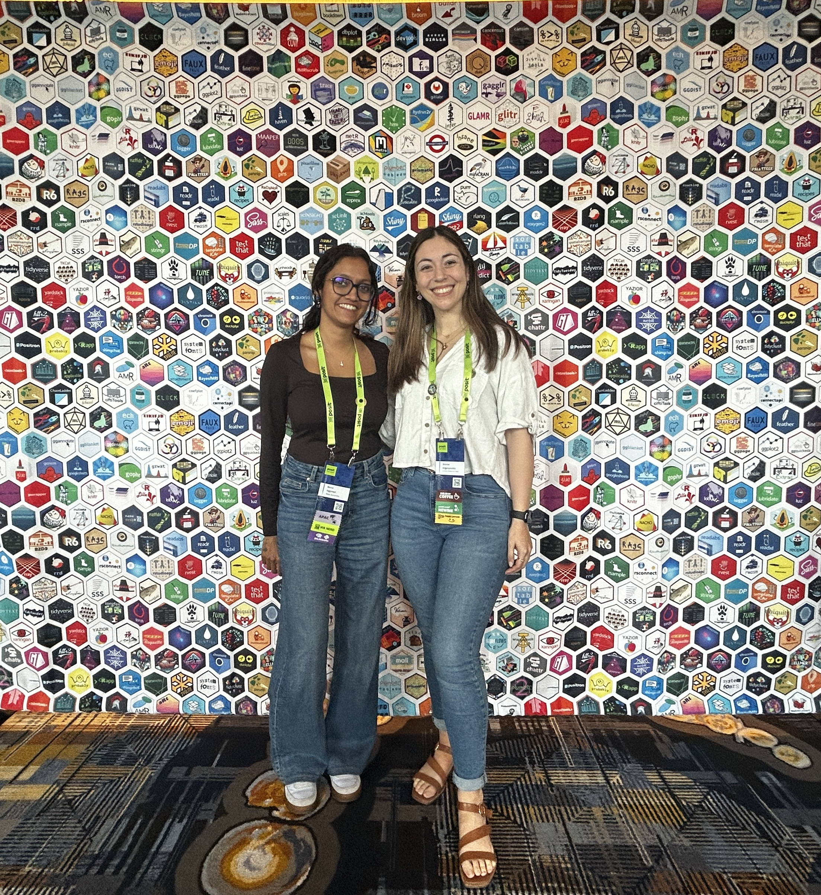
:::

::: {.column width="50%"}
::: {.fragment}
We are [Mansi]{.violet} and [Dionne]{.violet}, committee members at [R-Ladies+ Melbourne]{.violet}
:::

::: {.fragment}
We both attended [posit::conf(2026)]{.violet} in Houston, Texas (USA) this September as part of the [Opportunity Scholars Program]{.violet}
:::

::: {.fragment}
Today we will discuss our journeys [before]{.rose-emph}, [during]{.blue-emph} and [after]{.green-emph} the conference! 
:::
:::
:::::

## About [Mansi]{.violet}

::::: rows

::: {.row height="40%" style="display: flex; justify-content: center; align-items: center; gap: 2em;"}

::: {.fragment}
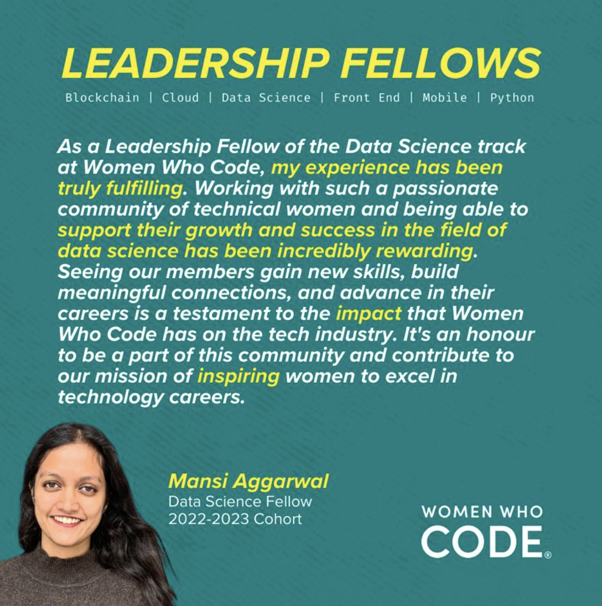{width="350px"}
:::

::: {.fragment}
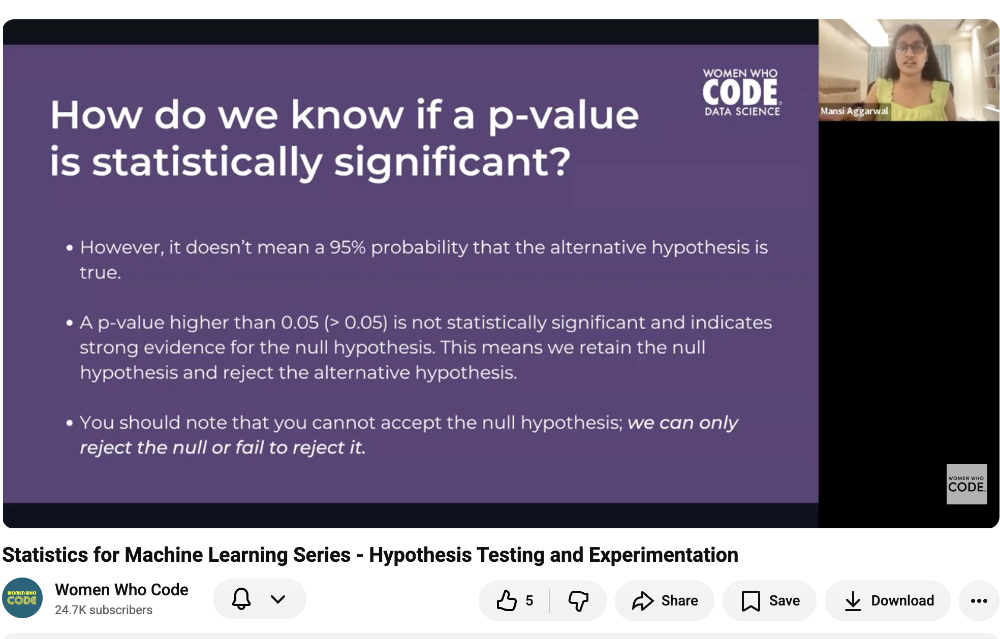{width="650px"}
:::

::: {.fragment}
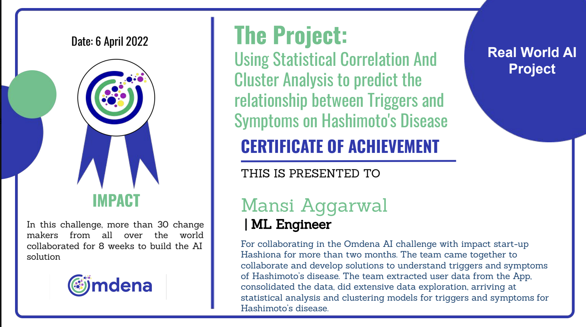{height="250px"}
:::

:::

::: {.row height="60%" style="display: flex; justify-content: center; align-items: center; gap: 2em;"}
::: {.fragment}
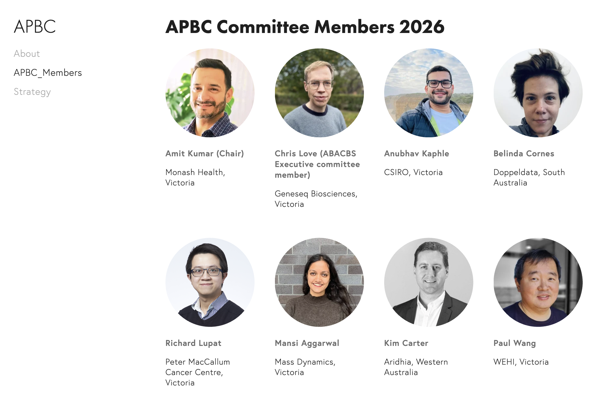{height="300px"}
:::

::: {.fragment}
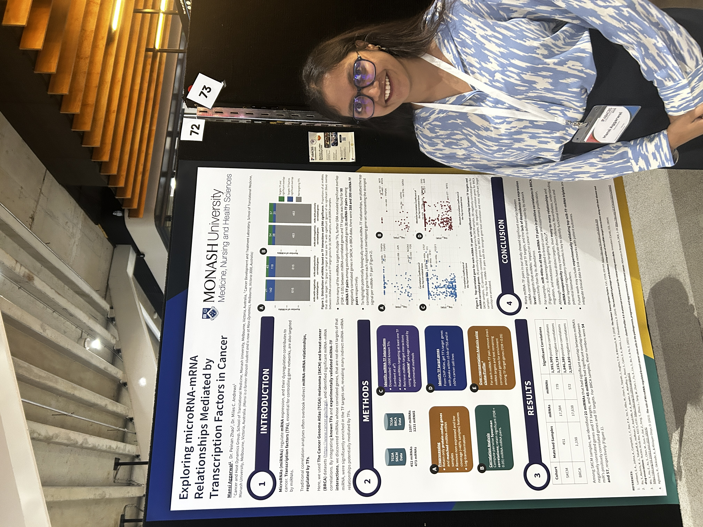{height="280px"}
:::

:::
:::::

## About [Dionne]{.violet} 

::::: rows

::: {.row height="50%" style="display: flex; justify-content: center; align-items: center; gap: 2em;"}
::: {.fragment}
](images/hex_serotrackr.png){height="250px"}
:::

::: {.fragment}
](images/hex_PvSeroApp.png){height="250px"}
:::

::: {.fragment}
](images/hex_wastewateR.png){height="250px"}
:::

:::

::: {.row height="50%" style="display: flex; justify-content: center; align-items: center; gap: 2em;"}
::: {.fragment}
](images/hex_melbourne.png){height="250px"}
:::

::: {.fragment}
](images/logo_rladies_1.svg){height="250px"}
:::

::: {.fragment}
](images/hex_vitae.svg){height="250px"}
:::
:::
:::::

:::{.notes}
- Experience with GitHub and Coding: 
  - Developer/maintainer of three R packages: `SeroTrackR`, `wastewateR`, `melbourne`
  - Developer/maintainer R Shiny Application: `PvSeroApp`
  - Written a paper on `SeroTrackR` and `PvSeroApp` fit-for-purpose tool 
  - Written my CV entirely using R Markdown via the `vitae` R package 
- Developer/maintainer of two websites: personal, R-Ladies+ Melbourne 
- Also had to provide three links: Updated my website, provided my GitHub and R-Ladies+ Melbourne website 
- Other coding contributions: ebooks for r-ladies+ melb, lab-based protocols, shiny app/r package; joined r dev day 2025
Experience in contributing to the community: 
- Treasurer (current), President since 2024-2026, VP in 2023, committee 
- Organise women and gender-minority led events
- Uplift women, non-binary and gender minority groups 
- Find speakers for events and lead contact for organisation (at the time)
- Veski: Inspiring the next generation of girls in STEM
:::

## Opportunity Scholars Program

Supported by [Posit PBC]{.violet} to fly to Houston for four nights, registration for [posit::conf(2026)](https://conf.posit.co/2026/) and a workshop; (optional) for [Tidy Dev Day](https://opensource.posit.co/blog/2026-06-25_tidy-dev-day-2026/)! 

::::: columns  
::: {.column width="50%" .center}
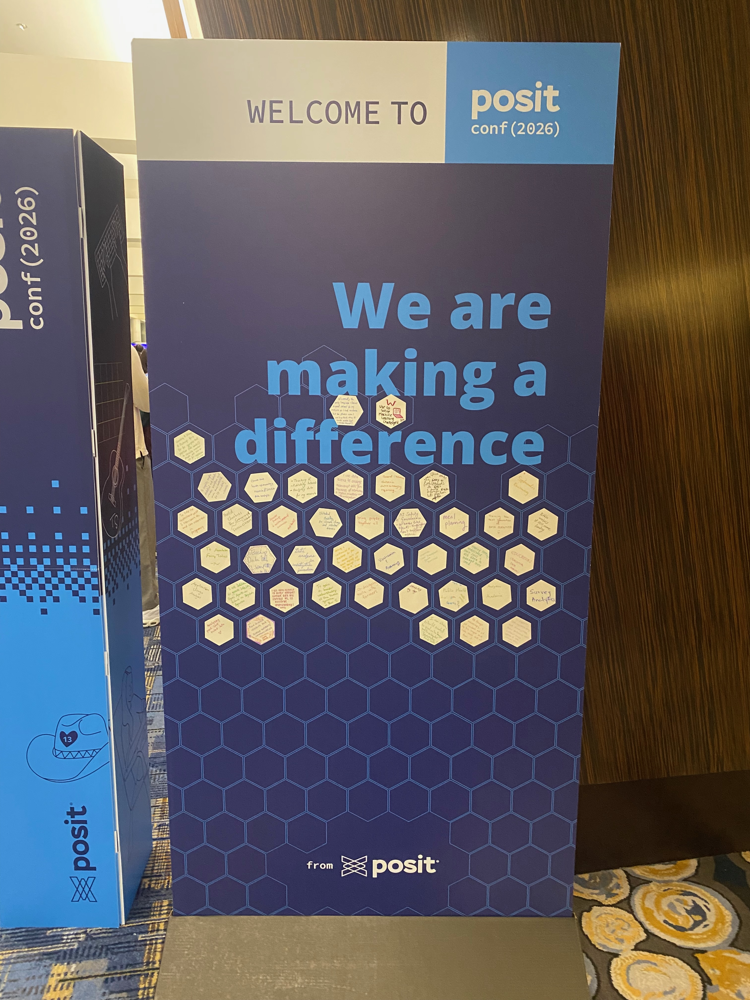{height="400px"}
:::

::: {.column width="50%" .center}
{height="400px"}
:::
:::::

## Timeline {.center}

::: {.timeline}
::: {.event data-label="Feb/Mar 2026"}
**Application**
📝 Draft and submit application
:::
::: {.event data-label="Apr 2026"}
**Decision**
🎉 Found out we were successful! 
:::
::: {.event data-label="Sept 2026"}
**Conference**
✈️ Fly to Houston, Texas 
:::
:::

## `posit::conf(2026) %>% glimpse()`{style="background:transparent; padding:0; font-size:inherit; color:inherit;"} {.big-statement data-menu-title="The Conference" background-color="#881ef9" style="font-size:55px;padding: 5px "}

## Workshop: "The Modern R Workflow"
*with Jenny Bryan and Hadley Wickham*

::::: {.content-center}

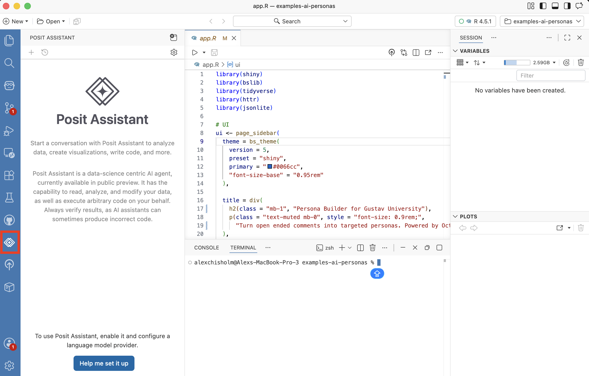

:::::

. . .

::: {.sticky color="#c8e6c9" top="120px" left="65%" width="16em" tilt="-3"}
[Positron IDE]{.violet-emph}: Built for data exploration, multilingual, workspaces are folders 
:::

. . .

::: {.sticky color="#c8e6c9" top="350px" left="65%" width="16em" tilt="-3"}
[Posit Assistant]{.violet} AI **harness** works within IDE, connects to session, can be used with many providers. 

[Posit AI Pass]{.violet} allow you to access many **models** through **one** subscription service
:::

::: {.notes}
- Day 1: workshop with Jenny Bryan and Hadley Wickham on AI-assisted coding.
- Built for data exploration, writing code (with/out AI)
- Familiar, RStudio-like and extensible, VSCode
- Multilingual 
- PA: Workspace is a folder (no .RProj)
- *No need to migrate from RStudio*
- It shows relative cost within the model picker
- Positron vs. RStudio: 
  - RStudio still best for day-to-day R; 
  - Positron wins if you work across languages, want to customise through extensions, workflows with multiple R sessions.
- Posit Assistant
  - Various tool calls that are intuitive and have specific user-input 
  -  Tool calls: `search`, `read`, `write`, `edit`, `execudeCode`, `bash`, `AskUser`, `webfetch`
- Posit AI Pass shows token use at all times and how you compare to others.
:::

## Workshop: "The Modern R Workflow"

*with Jenny Bryan and Hadley Wickham*

. . . 

[AI/R Tips]{.violet}

💡 `/clear` conversations regularly

💡 Use `AGENT.md` to store regular instructions

💡 Ask agent to "talk like a caveman": succinct and saves tokens

💡 Create skills to avoid common pitfalls 

💡 `{air}` (formatting), `{pak}` (installing packages), `{rig}` (multiple R installations)

. . .

::: {.slop-card}
NEVER MAKE ANOTHER HUMAN READ AI SLOP
:::

::: {.notes}

- `AGENTS.md`: instructions the AI reads every session
- If AI writes your code, **comment as a human**
- Tip: put "talk like a caveman" in your AGENTS.md — saves tokens and gets to the point.
- `/clear` the Posit AI conversation regularly: conversations are additive and it resends everything in the conversation every time you continue a conversation, increasing the number of tokens used
- On tokens: 
  - Tools exist like agentsview.io shows how many tokens you use and what it costs.
- AGENT.md is a way to avoid repeating yourself across multiple conversations, apply personal preferences across projects, keep them minimalist and not build them up too much. 
- Create skills to save tokens by avoiding common pitfalls and to steer it in the right direction to something more efficient
- Use tools like `air` for formatting, `pak` for installing R packages and `rig` to manage multiple R installation
- Kimi K3 strongly recommended as a very capable model for a reasonable price
- Terminology: 
  - “Harness” provides the tools (e.g., Posit AI), 
  - “Model” is the specific LLM (e.g. Kimi K3) and 
  - “Provider” is who runs the server that runs the model (e.g. posit.ai) 
  - An agent is a model, inside a harness, running a loop, using tools, to achieve a goal. 
- Urge the audience: if you use AI for code, at least edit the comments yourself so a human voice stays in the code.

:::

## Dionne's Conference Highlights {.center}

## Session that's stayed with me: Teaching at the Frontier
<!-- Dionne -->

*with Mine Cetinkaya-Rundel, Marc Dotson, Derrick Cogburn, Christian Martinez*

::::: {.content-center}

:::: {.columns .v-center .balance}

::: {.column width="48%" .card .card-hl .fragment .fade-in}
### Problem 1: 
Teaching how to code in the AI era
:::

::: {.column width="48%" .card .card-hl2 .fragment .fade-in}
### Solution: 
Teach clear AI best-practices, coding workflow, assess [judgement]{.violet-emph} and [syntax]{.violet-emph}  
:::
::::

<div style="height: 2em;"></div>

:::: {.columns .v-center .balance}

::: {.column width="48%" .card .card-hl .fragment .fade-in}
### Problem 2: 
Students learn for a semester, but forget after. 
:::

::: {.column width="48%" .card .card-hl2 .fragment .fade-in}
### Solution: 
Encourage students to reflect, promote active learning through encouragement and feedback
:::

::::

::: {.fragment .fade-in .balance-line}
Directly impact my developing pedagogical values as a teacher: 

Shifting AI as a shortcut to [learning support]{.violet-emph}, and fostering [creativity]{.violet-emph}. 
:::

:::::

::: {.notes}
This session was eye-opening for me as an academic supervisor and emerging tertiary teacher. 
This year was my first year as the Head tutor of Coding and Data Analysis in Biomedicine and next year I will assume the role of co-coordinator. 
I wanted to learn how to teach code effectively and utilise the new tools at our disposal. 

The problem is teaching in the AI era is difficult, when students are learning to code but can simply go to AI who can do a pretty good job, but students don’t have the skill set to learn when AI is wrong. 

The solution from these experienced teachers suggested to: 
- Integrate AI guide and prompt engineering into classes throughout semester, provide explicit best AI practices 
- Don't expect memorisation; expect knowing how to use and verify code, and assessments can both evaluate the judgement and syntax 
- There is a clear emphasis on teaching students about workflows and version controls, and shift AI from a shortcut to a learning support 
- Examples of using an AGENTS.md file or other built-in AI agents with integrated pedagogical guardrails 

Another problem is that often when we teach code, students are motivated and learn a lot, but then after the class they forget everything. 

Christian Martinez had a striking talk about encouraging students to reflect on their work, and create a profile they can refer back to. He called this the "accidental author" model where students were invited to revise or resubmit previous weekly assignments, and create a public-facing quarto book that they can refer back to, or even add to their CV as a tangible output from the class. Because students make their own books, they get creative and go down fun rabbit holes.

This session directly will impact how I approach my role as co-coordinator next year: i want to balance AI use with fostering creativity 
:::

## New developments that I know will change my life 

<!-- This will be rapid fire without a lot of detail! -->

::::: rows

::: {.row height="50%" style="display: flex; justify-content: center; align-items: center; gap: 2em; font-size: 0.7em"}

:::::: columns

::: {.column width="33%" .fragment}
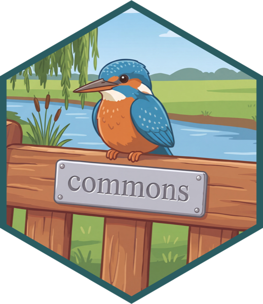{height="180px"}

Provide [trusted code]{.violet} to help AI systems
::: 

::: {.column width="33%" .fragment}
{height="180px"}

Browse React.dev components, use them in Shiny
::: 

::: {.column width="33%"}
 {height="180px"}
::: 
::::::

:::

::: {.row height="50%" style="display: flex; justify-content: center; align-items: center; gap: 2em; font-size: 0.7em"}
::: {.column width="40%"}
{height="180px"}
{height="180px"}
::: 
::: {.column width="40%"}
 {height="180px"}
{height="180px"}
::: 
::: {.column width="20%"}
 {height="180px"}
::: 
:::

:::::

:::{.notes}
1. Introducing the `{commons}` R package: 
- *Innovation*: Trusted code for AI systems
- *Why it matters*: Ensures AI has reliable, vetted resources to work with 
- Asked the question: *How can we design AI systems to produce better work?*
- Help the agent be correct and make it less bad when wrong (sound statistics, reproducible practices, trusted code)
- By providing trusted code known to be correct
- Signals in response of high and low trust
- As a teacher/supervisor: A way to ensure AI-generated content students rely on is accurate and aligned with what we teach.

2. Introducing the `{shinyreact}` R package: 
- *Innovation*: use React.dev components directly in shiny
- *Why it matters*: Access modern web components without rebuilding them
- React is a JavaScript library for building interactive user interfaces with reusable components 
- and is incredibly popular, with over 100 million downloads per month. 
- Compared with shiny's 50 million downloads in 14 years, that's a lot. 
- It has a massive ecosystem of pre-built components that you can use.
- `{shinyreact}` lets us bring React into shiny whilst keeping the R server logic intact, 
- giving us a way more design flexibility and responsiveness than Shiny's current built-in UI functions alone
:::

## Shiny in Pieces: `{shinyreact}`

::: magic-move 

```{r}
#| echo: true
#| eval: false
library(shiny)

ui <- fluidPage(
  tags$head(
    tags$style(HTML(
      "
      .greeting-box {
        background: linear-gradient(135deg, #667eea 0%, #764ba2 100%);
        color: white;
        padding: 20px;
        border-radius: 10px;
        margin-top: 20px;
        font-size: 18px;
        text-align: center;
        box-shadow: 0 4px 6px rgba(0, 0, 0, 0.1);
      }
      .input-section {
        background-color: #f8f9fa;
        padding: 15px;
        border-left: 4px solid #667eea;
        border-radius: 5px;
      }
    "
    ))
  ),

  div(
    class = "container",
    style = "margin-top: 40px;",
    h1("✨ Personalised Greeting App", style = "text-align: center;"),

    div(
      class = "input-section",
      textInput("name", "Enter your name:", placeholder = "Type here..."),
      p(
        "We'll create a custom greeting just for you!",
        style = "color: #666; font-style: italic;"
      )
    ),

    div(class = "greeting-box", textOutput("greeting"))
  )
)

server <- function(input, output, session) {
  output$greeting <- renderText({
    if (input$name == "") {
      "👋 Welcome! Enter your name above."
    } else {
      paste0("🎉 Hello, ", input$name, "! Welcome to our app!")
    }
  })
}

shinyApp(ui, server)
```

```{r}
#| echo: true
#| eval: false
library(shiny)
library(shinyreact)

server <- function(input, output, session) {
  output$greeting <- reactive_output({
    list(message = paste0("Hello, ", input$name))
  })
}

shinyApp(page_react(), server)
```

::: 

::: {.notes}
- This giant chunk of code becomes way simpler, and your UI and server stay nicely separated 
- Because instead of writing all your UI logic in R, you can move it to a seprate `.tsx` Javascript file
- which can even be generated with AI 
- and then bind your server logic to it using `reactive_output()`
:::

## New developments that I know will change my life 
<!-- Dionne -->

::::: rows

::: {.row height="50%" style="display: flex; justify-content: center; align-items: center; gap: 2em; font-size: 0.7em;"}

:::::: columns

::: {.column width="33%"}
{height="180px"}

Provide [trusted code]{.violet} to help AI systems
::: 

::: {.column width="33%"}
{height="180px"}

Browse React.dev components, use them in Shiny
::: 

::: {.column width="33%" .fragment}
{height="180px"}

Including Quarto2, QuartoHub, `quarto-revealjs-editable`
::: 
::::::

:::

::: {.row height="50%" style="display: flex; justify-content: center; align-items: center; gap: 2em; font-size: 0.7em;"}

:::::: columns

::: {.column width="40%" .fragment}

{height="180px"}
{height="180px"}

`{mirai}`: Async, never wait for a result

`{mori}`: Shared memory: one copy, many readers

:::

::: {.column width="40%" .fragment}
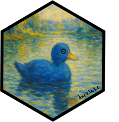{height="180px"}
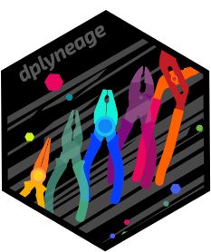{height="180px"}

`{ducklake}`: Database versioning in R

`{dplyneage}`: Column-level lineage for `{dplyr}`
:::


::: {.column width="20%" .fragment}
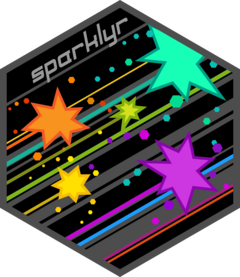{height="180px"}

Tune `{tidymodels}` in Databricks via `tune_grid_spark()` 
:::

::::::

:::
:::::

::: {.notes}
3. Quarto ecosystem: Emil Hvitfelt, Carlos Scheidegger
- Innovation: Quarto 2 (100x faster, build with Rust), QuartoHub (real-time collaboration), `quarto-revealjs-editable` (drag-and-drop slide editing)
- Why it matters: Faster rendering, collaborative workflows, intuitive UI for non-coders
- Future of quarto 
- Showcased these new platforms which include fast real-time rendering, browswer based editors, comments, track changes
- Allows users to operate within quarto that makes sense for a user-interface: 

Quick shout outs to some other amazing innovations and packages: 

4. `{mirai}` + `{mori}`
- Asyncronous tasks that never block each other; shared memory for efficient scaling
- Shiny apps handle many more concurrent users without crashing 

5. `{ducklake}` + `{dplyneage}`
- Database versioning, column-level lineage tracking 
- Full reproducibility and traceability from raw data to analysis 

6. `{tidymodels}` on Databricks
- A new function called `tune_grid_spark()` allows model models at scale with the similar arguments to `tune_grid()`
- This allows us to leverage distributed computing for hyperparameter tuning 
:::

## Tidy Dev Day

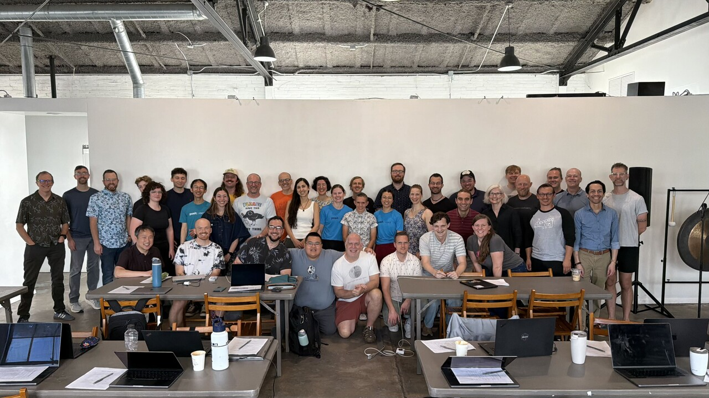

## Tidy Dev Day

Worked on tidymodels issues `tidymodels#154`

::: {.columns}

::: {.column width='60%'}

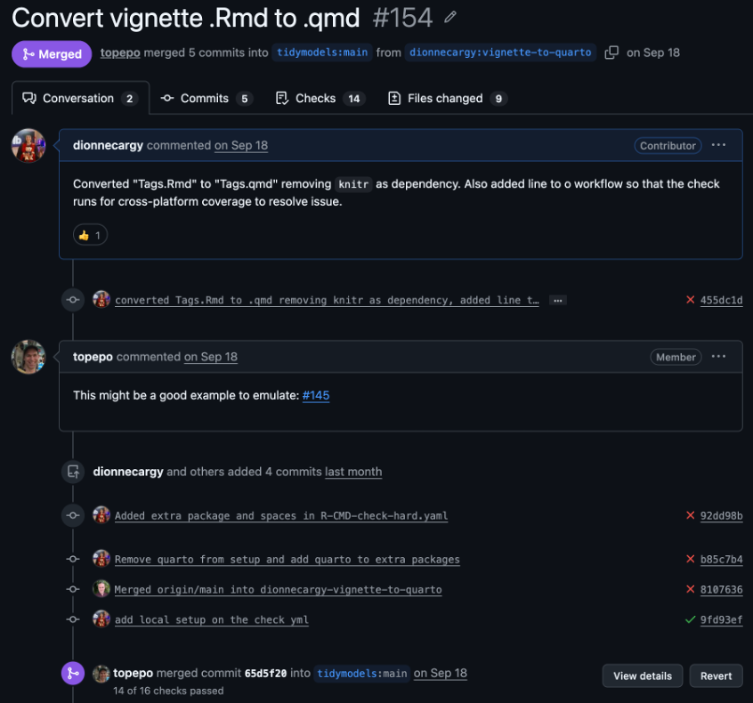

:::

::: {.column width='40%'}

{width="75%"}

:::

:::

## Tidy Dev Day

Worked on tidymodels issues `tidymodels/tune#1200`

::: {.columns}

::: {.column width="60%"}

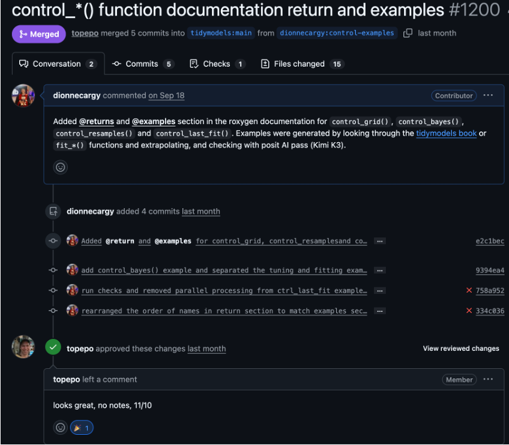

:::

::: {.column width="40%"} 

```{r}
#| eval: false
#| echo: true
#| code-overflow: scroll
#'
#' @return An S3 object of class `control_grid` (also used for `control_bayes`,
#' `control_resamples`, `control_last_fit`) used to contain the
#' control settings in a grid search as a list.
#'
#' @examples
#'
#' library(recipes)
#' library(rsample)
#' library(parsnip)
#' library(workflows)
#'
#' set.seed(1234)
#'
#' folds <- vfold_cv(mtcars, v = 5)
#'
#' recipe <- recipe(mpg ~ ., data = mtcars) |>
#'   step_normalize(all_numeric_predictors())
#'
#' # Model with tuning parameters, used for `tune_grid()` and `tune_bayes()`.
#' spec <- mlp(
#'   hidden_units = tune(),
#'   penalty = tune()
#' ) |>
#'   set_engine("nnet") |>
#'   set_mode("regression")
#'
#' wf <- workflow() |>
#'   add_model(spec) |>
#'   add_recipe(recipe)
#'
#' # ---------------------------------------------------------------------------
#' # control_grid(): Modify tuning process in `tune_grid()`.
#' ctrl <- control_grid(
#'   # save out-of-sample predictions
#'   save_pred = TRUE,
#'   # print progress while tuning
#'   verbose = TRUE
#' )
#'
#' tune_grid(
#'   wf,
#'   resamples = folds,
#'   grid = 5,
#'   control = ctrl
#' )
#'
#' # ---------------------------------------------------------------------------
#' # control_bayes(): Modify tuning process in `tune_bayes()`.
#' ctrl_bayes <- control_bayes(
#'   save_pred = TRUE,
#'   verbose = TRUE
#' )
#'
#' set.seed(3246)
#' tune_bayes(
#'   wf,
#'   resamples = folds,
#'   initial = 5,
#'   iter = 10,
#'   control = ctrl_bayes
#' )
#'
#' # ---------------------------------------------------------------------------
#' # `fit_resamples()` and `last_fit()` can't use `tune()` placeholders, so for
#' # `control_resamples()` and `control_last_fit()` we use a model with fixed
#' # parameters.
#' # ---------------------------------------------------------------------------
#' # control_resamples(): Retain out-of-sample predictions and fitted workflows
#' # in the grid and each fold.
#' spec_fixed <- linear_reg() |>
#'   set_engine("lm")
#'
#' wf_fixed <- workflow() |>
#'   add_model(spec_fixed) |>
#'   add_recipe(recipe)
#'
#' keep_pred <- control_resamples(
#'   save_pred = TRUE,
#'   save_workflow = TRUE
#' )
#'
#' fit_resamples(
#'   wf_fixed,
#'   resamples = folds,
#'   control = keep_pred
#' )
#'
#' # ---------------------------------------------------------------------------
#' # control_last_fit(): Control last fit process by printing progress.
#' split <- initial_split(mtcars)
#'
#' ctrl_last_fit <- control_last_fit(verbose = TRUE)
#'
#' last_fit(
#'   wf_fixed,
#'   split = split,
#'   control = ctrl_last_fit
#' )
```

:::

:::

::: {.notes}
 Day 4: Tidy Dev Day, contributing to tidyverse packages.
- Resolved tidymodels/tidymodels#144; parsnip#1354 was already fixed; brulee#39 was more involved than anticipated.
- Great place to meet like-minded folks across fields, expertise, and experience levels — and contribute to the code we all use.
:::

## I feared my skills will atrophy {.big-statement data-menu-title="dionne-thoughts" background-color="#e5cdff" style="font-size:60px;padding: 5px "}

But it became clear that the [fundamentals]{.violet} will never cease to be [important]{.violet}. 

. . . 

Using AI tools with [clear intentions]{.violet} and [careful scrutiny]{.violet} can help us achieve our goals.

<!-- Dionne End -->

::: {.notes}
- "Before trusting the scores, validate the Judge"
Humans have never been [more important]{.violet} in the unstable AI era

:::

<!-- Mansi -->
## Mansi's Major Takeaways {.center}

## {.center}

::: {.incremental}
- Thinking differently about AI 👩🏽‍💻
- Consumption vs Creation 🛠️
:::

## I have often been an AI skeptic... 

::::: {.columns .v-center}

:::: {.column width="55%" .fragment .fade-in fragment-index=1}
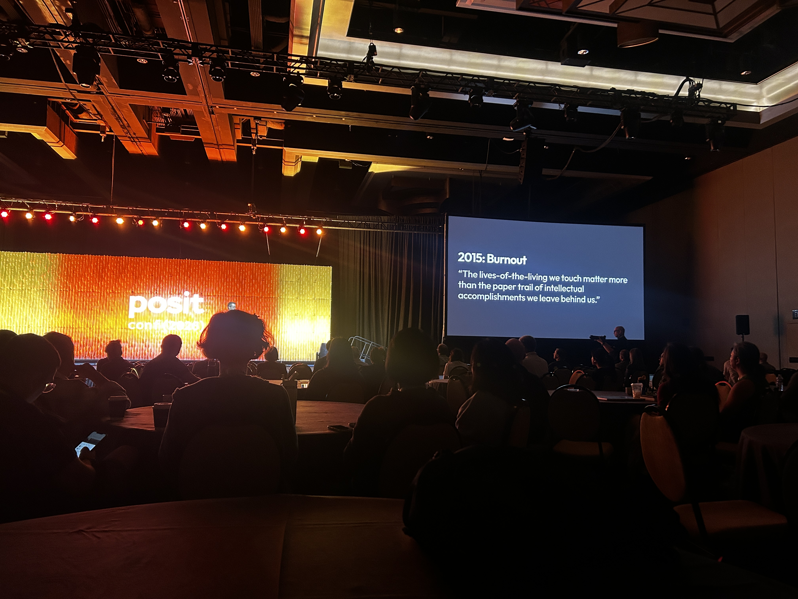{width="100%"}
::::

::: {.column width="45%"}
[But one thing that stood out across the conference was how thoughtfully people are engaging with AI,]{.fragment .fade-in fragment-index=1} [not as a replacement for [human expertise]{.violet},]{.fragment .fade-in fragment-index=2} [but as a tool that can enhance [creativity, productivity, communication, teaching, and scientific discovery.]{.violet}]{.fragment .fade-in fragment-index=3}
:::

:::::

## Some standout AI sessions (and learnings!)  {transition="fade"}


::::: rows

::: {.row height="40%" style="display: flex; justify-content: center; align-items: center; gap: 2em;"}
::: {.fragment}
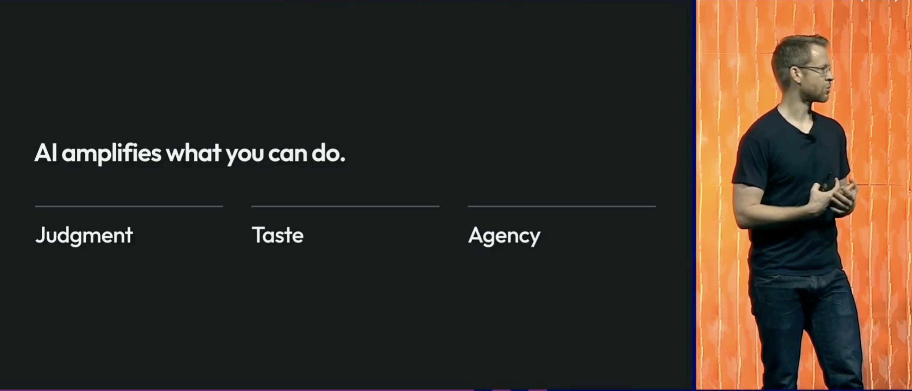{height="200px"}
:::

::: {.fragment}
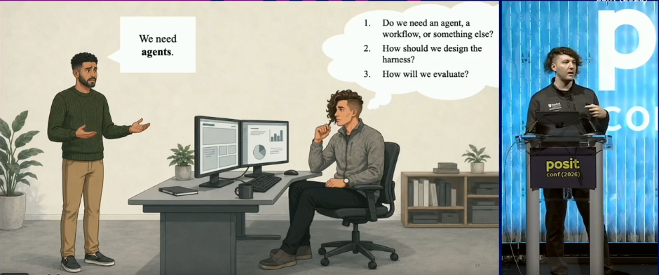{height="200px"}
:::
:::

::: {.row height="40%" style="display: flex; justify-content: center; align-items: center; gap: 2em;"}
::: {.fragment}
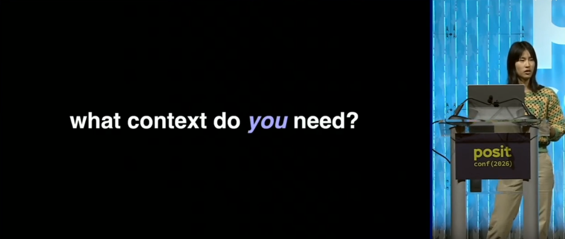{height="200px"}
:::

::: {.fragment}
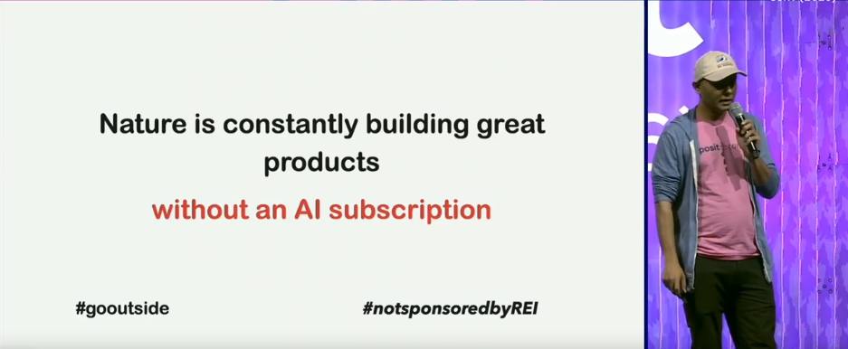{height="200px"}
:::
:::

:::::

## {.center}
::: {.fragment .fade-in}
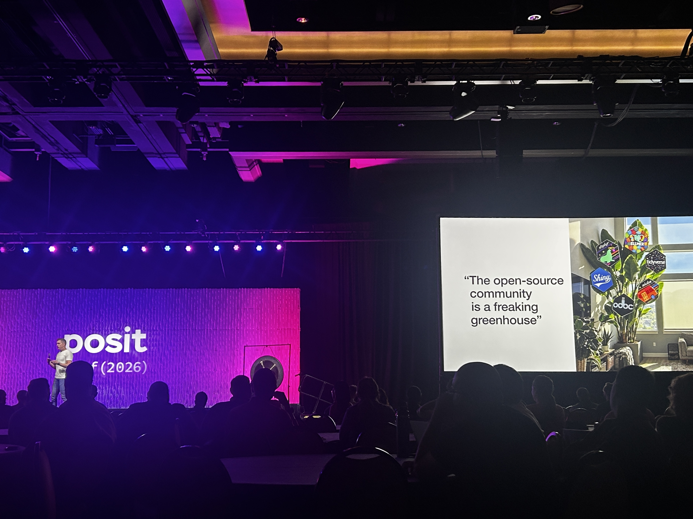{fig-align="center" height="600px"}
:::

## {.center}


::: {.photo-free}
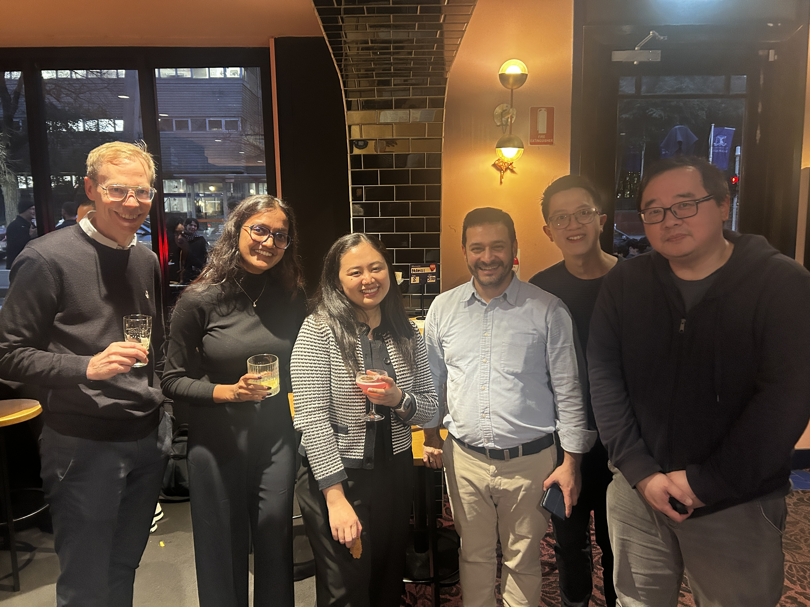

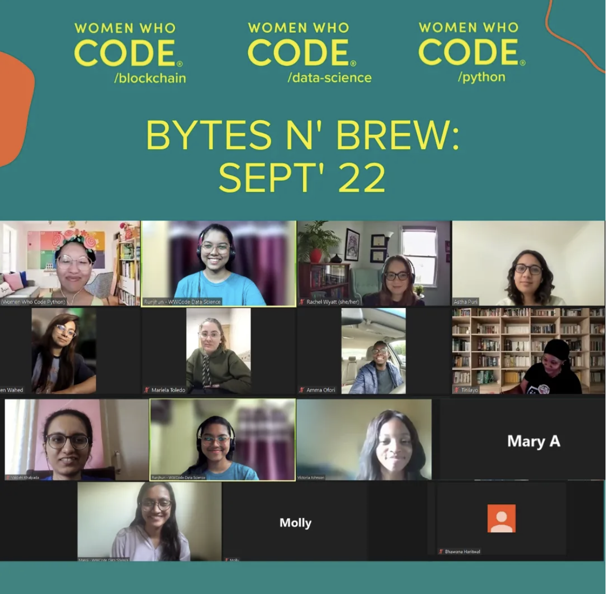
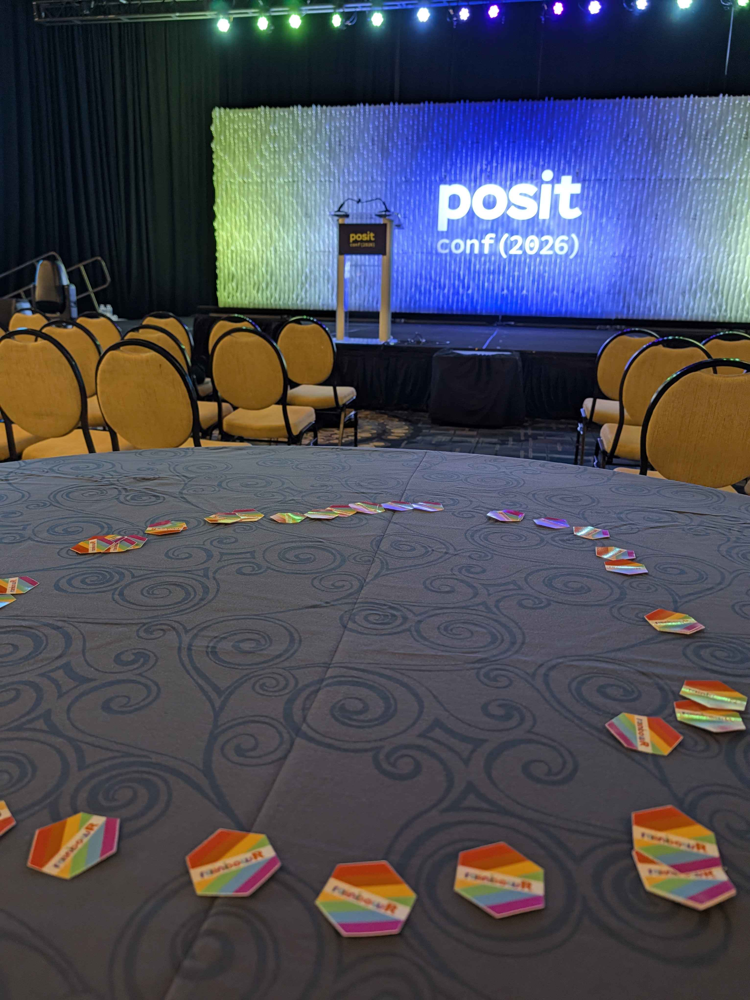
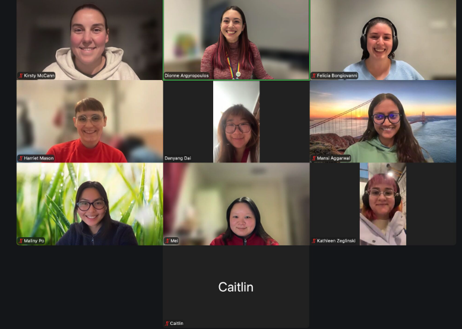
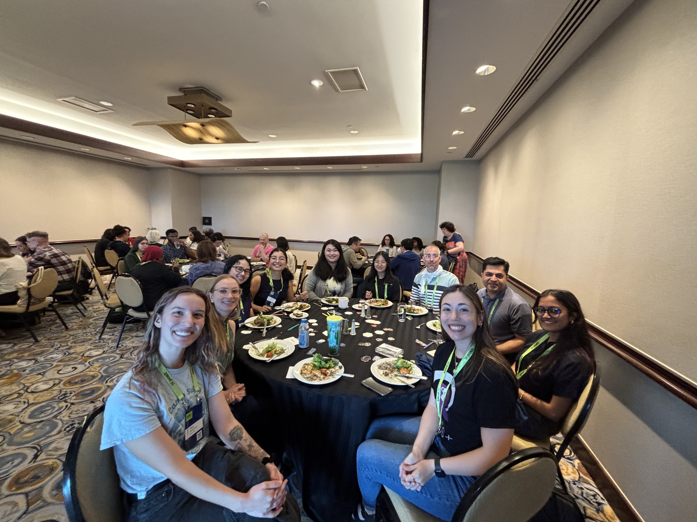
:::

## Consumption vs Creation {transition="fade"}
::::: {.content-center}

:::: {.columns .v-center .balance}

::: {.column width="48%" .card .card-hl .fragment .fade-in}
### Consuming
Talks, docs, packages, other people's code

*How I learn*
:::

::: {.column width="48%" .card .card-hl2 .fragment .fade-in}
### Creating
Contributing, writing, sharing back

*How I can give back*
:::

::::
::: {.fragment .fade-in .balance-line}
I want to strike a balance between the two, and I'm more inspired to contribute more to the [open source community]{.violet}!
:::

:::::


<!-- Mansi End-->


## 

::::: {.content-center}

::: {.incremental}
- **Stay curious, stay critical** – it's OK to be a skeptic, but [engage thoughtfully]{.violet} with AI
- **Own the problem** – the clearer your problem statement, the more useful AI becomes
- **Keep the human in the loop** – [human expertise]{.violet} is what makes AI output trustworthy
- **Give back** – share what you learn: blog it, talk about it, contribute to a package
- **Find your people** – communities like [R-Ladies+]{.violet} are where the creating starts 💜
:::

:::::

## Advice for Opportunity Scholars 2027

- Be active in your R communities 
- Make a website! 
- Join R/Tidy Dev Days, Data Hangouts, Hackathons
- Compile a list of your R skills 

<!-- Mansi and Dionne's Group Hangs! -->
## 

```carousel
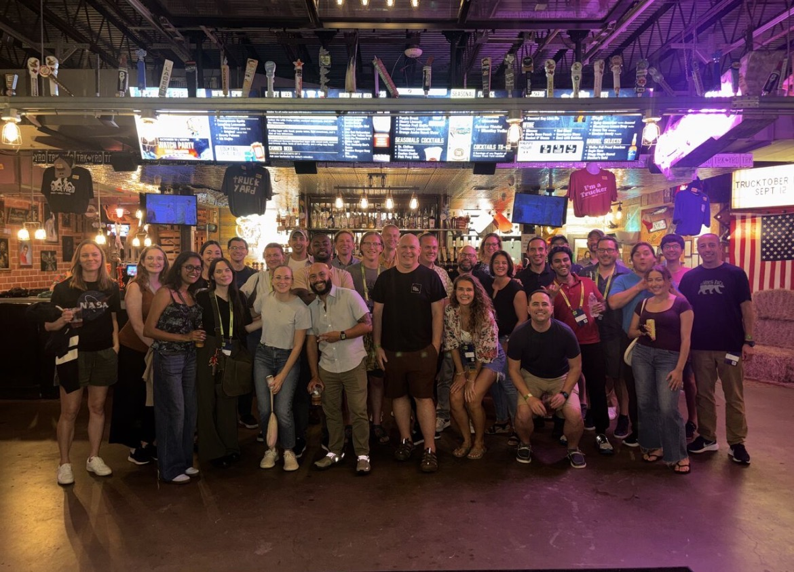
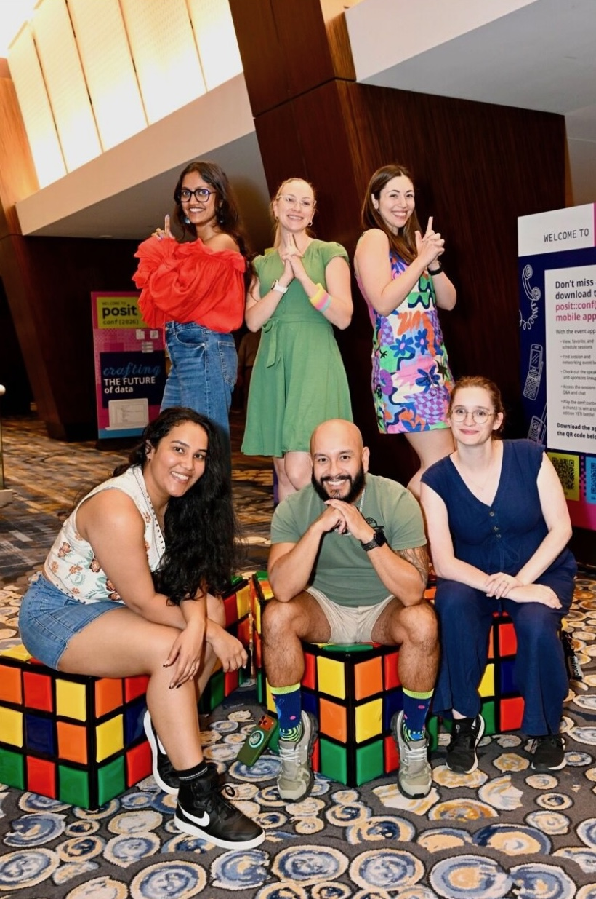
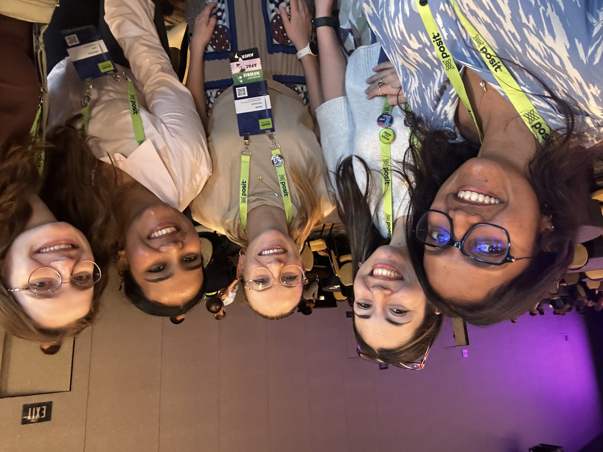
```

## `posit::conf(2026) %>% glimpse(questions = "?")`{style="background:transparent; padding:0; font-size:inherit; color:inherit;"} {#FinalSlide .big-statement data-menu-title="Thank-you" background-color="#881ef9" style="font-size:50px;padding: 5px "}

{height="180px" fig-align="center"}

::: {.notes}
- All talks will be available on YouTube in December! 
- Thank the organisers, opportunity scholarship, R-Ladies+ Melbourne.
- Invite questions; links to all talks available.
- Thank r-ladies for giving me opportunities to grow and promo our 10 year event!!! include flyer if we have it !! 
:::